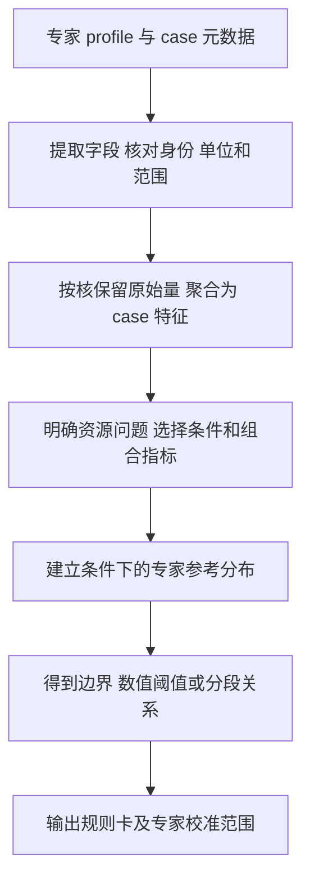

# 从专家 profile 形成规则卡的方法

本阶段的产物是 AIV 规则卡 prototype。每张卡记录一个资源问题、适用条件、指标计算方式和由专家数据校准的参考边界。客户 profile 满足条件后，可以计算指标并报告相对参考边界的偏离。

现有数据足够开始这个 prototype。首轮使用 9 个 TileKernels 算子族、54 个不同 case 的 72 份单 kernel profile。本文将工作展开到专家校准后的规则卡草案，客户算子的验证另行开展。

## 1 处理流程

每一步都保留原始文件路径和计算依据。所有时间、字节、占比先按资源含义定义，再决定怎样进入同一张卡。

## 2 输入数据和基本统计单位

### 2.1 统计单位

- **算子 case**由数学任务、shape、dtype 和相关属性确定。
- **kernel 角色**标识该算子中实际被采集的目标，例如 RoPE 的 Q 和 K。
- **采集记录**标识一次目标 Default，内部的多个 PMU 重放组共同构成这份记录。
- **资源行**用 `(block_id, sub_block_id)` 标识，AIV、AIC 和混合执行分别选择对应核侧。

一份 Default 的基础信息主要描述目标 kernel/task。框架算子包含多个 kernel 时，算子端到端时间和各 kernel 的资源统计分别保存。

同一个 case 的复采保留为稳定性信息。专家分布按独立 case 建立，复采次数多的 case 不增加相应权重。核间分布使用各 block 的数据，独立 case 数仍按 case 计。

### 2.2 提取记录

| 记录类别 | 必须保存的信息 | 作用 |
|---|---|---|
| 采集来源 | 文件路径、哈希、设备型号、工具和运行时版本 | 追溯字段语义与采集口径 |
| 计量范围 | kernel 角色、单 kernel 或 range、replay、L2 条件、预热及调用次数 | 判断观测窗口是否可比 |
| case 合同 | 输入输出 shape/dtype、算子属性、输出身份、已知布局与 alias | 描述任务规模和资源需求 |
| 工作特征 | 归约宽度、有效元素或行数、mask/稀疏特征、已知复用机会 | 为工作量归一化和机制分组提供依据 |
| 资源身份 | Op Type、Block Dim、Mix Block Dim、资源行唯一键 | 确定读哪些核侧和行 |
| 原始字段 | 字段名、单位、数值、缺失情况、所属 PMU 表 | 计算基础量及派生量 |

源码可补充必要的工作量或布局信息。规则本身按资源条件定义，同条件的多种源码写法接受同一检查。

### 2.3 数据质量处理

先检查目标任务是否明确、资源键是否重复或缺失、单位是否匹配。未知值保留 NA。分母为零时记录该指标无法计算的原因。计数范围与所研究资源路径不一致时，拆分路径或单列为待解释。

Pipe 活动占比的跨核汇总使用对应总周期。Cache 命中率使用对应请求事件数。等待和冲突占比先保留其原始定义，只有已确认分母时才跨核加权。各表来自不同 PMU 重放组时，组合量记录其来源，时间上的同步关系需要相应时序信息。

## 3 从原始字段到基础量

下表以现有 AIV Default 为起点。所有求和都只包含当前目标、当前核侧的唯一资源行。

| 基础量 | 字段来源 | 定义和单位 |
|---|---|---|
| kernel 时间 | OpBasicInfo 的 Task Duration | 一次目标任务时间，µs |
| 每 block 总时间和周期 | PipeUtilization 的 aiv_time、aiv_total_cycles | 记为 t_i、c_i |
| Vector 活动 | aiv_vec_time | 记为 v_i，µs |
| Scalar 活动 | aiv_scalar_time | 记为 s_i，µs |
| MTE2、MTE3 活动 | aiv_mte2_time、aiv_mte3_time | 记为 a2_i、a3_i，µs |
| 主存计数 | Memory 的 read_main_memory_datas、write_main_memory_datas | 读取表头 KB 的数值，乘 1024 得到 R_i、W_i，B |
| GM→UB 路径计数 | Memory 的 GM_to_UB_datas | 同样换算为 G_i，B |
| 搬运指令数 | aiv_mte2_instructions、aiv_mte3_instructions | 记为 n2_i、n3_i |
| 原生活跃带宽 | PipeUtilization 的 aiv_mte2_active_bw 等 | 本次固定版本的表头 GB/s 实际按 1024³ B/s 换算，记录为 GiB/s 数值 |
| 计算构成 | ArithmeticUtilization 的 VF、SFU、SIMT-VF 等占比 | 保留原值及总周期 |
| Cache、等待、冲突 | L2Cache、ResourceConflictRatio、ICache miss | 保留事件、比例和分母定义 |

Vector、Scalar 和 MTE 活动可能重叠。跨核活动时间相加后的单位为 core-µs，表示累计资源活动量。kernel 的墙钟时间另列。

GM→UB、主存读、UB→GM、主存写分别保留。它们是否覆盖同一批事务，由对应工具和架构的事件定义决定。

单位换算依据本次固定版本的解析源码：KB 除以 1024，GB 除以 1024³。原生带宽与自行重算值比较时使用这一约定；若展示十进制 GB/s，需显式转换。

## 4 派生指标的计算目录

这里先定义可计算的观察量。某个观察量是否具有报警价值，在后续专家分布中决定。

### 4.1 计算和控制开销

累计活动量为

\[
S_V=\sum_i v_i,\qquad S_S=\sum_i s_i
\]

周期加权 Vector 占比为

\[
u_V=\frac{\sum_i c_i\,p_{V,i}}{\sum_i c_i}
\]

Scalar 和 MTE 占比按同样方式使用相应字段计算。活动时间与对应总时间口径一致时，也可计算 `Σ活动时间 / Σ总时间`，并注明计算来源。

若能定义有效工作量 Q，可计算 `S_V/Q`、`S_S/Q`。Q 可以是有效处理元素、行或另一种明确工作单位。涉及归约时还需记录归约宽度，涉及 SFU 时需区分运算构成。相同元素数的 add、softmax 和 hash 分别建立机制条件。

### 4.2 搬运工作量和搬运粒度

\[
R=\sum_i R_i,\quad W=\sum_i W_i,\quad G=\sum_i G_i
\]

当 GM→UB 字节和 MTE2 指令计数覆盖同一路径时，平均计数粒度为

\[
b_2=\frac{G}{\sum_i n2_i}\quad[\mathrm{B/instruction}]
\]

保留各 block 的粒度分布，case 级比值按总字节和总指令数计算。`G/Q`、`R/Q`、`W/Q` 描述单位工作的路径成本，所需 Q 和路径条件随资源问题明确。输出与输入大小关系本身不规定效率方向。

当前 950PR 固定工具版本中，GM→UB 字节与 MTE2 active bandwidth 的分子采用相同事件表达，MTE2 指令数和活动时间也已核对。因此主池可计算 b2 和对应的服务效率。跨 PMU 组的字段仍表示重放所得统计量，不提供同时发生的时序证据。

### 4.3 搬运服务效率和活动程度

优先保存工具原生活跃带宽。其 case 级汇总可按相应搬运活动时间加权。

以 MTE2 为例，取 `B=ΣG_i`，`A=Σa2_i`，`T=Σt_i`。B 的单位为字节，A、T 的单位为 core-µs。三者覆盖相同资源行、对应同一路径且采集条件一致时，可以定义

\[
BW_a=B/A,\quad u=A/T,\quad BW_w=B/T=u\,BW_a
\]

这个等式用于整理变量依赖。平均带宽低可能来自忙时传得慢，也可能来自活动时间占比较少。三个量按一组有关联的证据处理。

这里 BW_a、BW_w 按累计核时间归一；整芯片吞吐另用 `B/TaskDuration` 计算。两种分母分别保存。BW_a 展示为与原生表头一致的 GiB/s 数值时，计算为 `B/A×10^6/1024³`。对原生活跃带宽按 a2_i 加权，在相同事件口径下应与该值一致，允许 CSV 舍入差异。

主存写计数和 MTE3 活动时间只有在路径关系已确认时才形成相应字节/时间特征。缺少 UB→GM 字节时，该路径的平均粒度和重算带宽保留缺失。

### 4.4 并行活动和核间分布

令有 Vector 活动的 block 集合为 `A={i | v_i>0}`，`n_A=|A|`，启动 block 数为 n。

\[
f_A=n_A/n,\qquad
B_V=\frac{\sum_{i\in A}v_i}{n_A\max_{i\in A}v_i}
\]

`f_A` 描述有活动的 block 比例，`B_V` 描述活动时间的均衡程度。另保留逐 block 总时间、读写量的分布和最忙 block。

将这些量用于报警时，需要说明预期工作分配、独立 tile 数、尾块和任务规模。相同指令条数未必意味着相同工作量。有活动的 block 数也需要与任务可用并行工作量一起解释。

### 4.5 Cache 和资源冲突

若已确认命中事件 H_i 与请求事件 D_i 的定义，整体命中率为 `ΣH_i/ΣD_i`。各架构的 close/far/victim 等分类按对应解析公式处理。

只有每核 hit rate 而缺请求分母时，保留其核间分布。低命中率与请求量、复用机会、工作集和 MTE 服务时间一起分析。等待、LDU/STU/SFU 冲突也分别保留分母，研究它们与计算或搬运成本的联合关系。

### 4.6 时间线指标

有同核、同窗口的充分时序数据时，才计算下列量。

| 指标 | 计算方式 | 条件 |
|---|---|---|
| 活动重叠 | 两条流水活动区间的交集时长，及其占较短活动区间的比例 | 时间轴对齐，明确所含 pipe 和阶段 |
| pipe 空隙 | 先合并同 pipe 重叠区间，再统计相邻忙区间之间的空隙 | 记录采样覆盖和缺失 |
| 起点平均间隔 | 对同核、同 pipe 的连续活动起点计算差值分布 | 明确起点代表发射还是执行开始 |
| 暴露等待 | 对应依赖链中影响阶段结束的等待 | 具备依赖或同步时序依据 |

`T/N` 描述平均吞吐节奏，`A/N` 描述每次事件的平均活动占用。完整的间隙和依赖关系需要时序。采样未覆盖的活动、VF 内部不可见指令、阶段起停分别标记。

## 5 如何形成组合规则

先确定卡片要描述的资源问题，再选择两到三个相关观察量。下面给出组合形式。

| 资源问题 | 可组合的量 | 组合的目的 |
|---|---|---|
| 搬入粒度与服务效率 | b2、MTE2 active bandwidth、MTE2 活动占比 | 区分粒度、忙时吞吐和活动程度 |
| 控制开销 | Scalar 占比、单位工作 Scalar 活动、Vector/SFU 构成 | 同时保留控制成本的分子、分母和计算背景 |
| 核间活动偏斜 | f_A、B_V、任务规模/预期分块 | 区分工作不足、工作分配与活动不均衡 |
| Cache 相关搬入成本 | hit rate、请求规模、单位工作搬入活动 | 区分缓存行为、请求量和服务成本 |
| 计算搬运协同 | 计算与搬运活动、重叠、等待 | 判断时间组织的差异 |

适用条件 C 优先描述硬件、计量口径、工作类型和数据形态。平均搬运粒度、服务效率和活动分布等可优化资源表现进入联合指标。若某张卡专门研究“给定搬运粒度下的服务效率”，可以建立带宽随粒度变化的边界，并把这个问题写进卡名和解释。

客户的异常数值不能成为排除该次检查的理由。按指标分段形成参考曲线时，要记录各段专家覆盖范围，超出覆盖时报告参考不足。

同条件专家可能在多个指标间存在取舍。组合可以采用专家二维参考区域、分段上/下边界或有明确含义的联合触发条件。联合边界应保留专家已经展示的组合。边界过宽或变量没有区分度时，保留为观察量。

## 6 条件怎样确定

| 条件类型 | 例子 | 在卡片中的处理 |
|---|---|---|
| 计量必要条件 | 同核侧、同路径、单位和窗口明确，字段有效 | 无法确认时给出缺失原因 |
| 机制条件 | 运算构成、归约宽度、布局、复用、片上容量、数据相关工作量、并行规模 | 作为分组和边界函数的输入 |
| 当前覆盖事实 | 样本来自哪些 shape、设备批次，启动数均为 56 | 列入校准范围，后续研究它对边界是否有影响 |

条件必须有资源含义，且能从客户 profile 和必要元数据确定。算子族名称用于观察各族是否有系统差异。若需要按任务类型分组，给出该任务类型影响资源需求的理由。

首版采用少量机制分组。数据中恒定的变量先记录为覆盖事实，避免把它未经分析地变成永久的必要条件。

## 7 threshold 如何由专家数据得到

### 7.1 先确定参考组

固定所研究资源问题、指标方向和条件 C。列出属于该条件的专家 case、算子族、shape/dtype 范围和有效采集数。首版按固定 profile ID 顺序，为每个 case 选一份合格代表采集，选择结果写入卡片的校准清单。同一张联合卡的各分量从这份代表采集计算。各 case 在参考分布中各占一个点。

复采单列各指标的波动范围，单次采集的波动记为未知。复采数量不改变 case 权重，也不自动扩大阈值。若以后采用不同的稳健代表方法，另行登记其定义。

### 7.2 一维参考边界

若该资源问题有明确的偏离方向，可以先采用可复算的专家观测边界。

- 上边界卡取 `T_C=max(m)`。
- 下边界卡取 `L_C=min(m)`。

这里的极值取自 C 中各 case 的代表值，记录是哪份样本决定边界。它表示 case 代表值的专家范围，各 case 的复采波动随边界另列。波动余量以实际复采和已登记的处理方法为依据。

若指标几乎恒定、处于计数分辨率附近，或偏离方向缺少明确资源含义，先输出统计描述。专家值范围本身不保证该指标能诊断客户问题。

### 7.3 多变量参考边界

对 `(x,y)`，可以在明确的资源条件下建立 `L_C(x)≤y≤T_C(x)`。首版采用有资源含义的少量分段，每段记录样本范围、case 数和算子族数。

若有效专家存在明显取舍，保留其二维区域或多个可接受分支。若使用联合触发，例如某量偏高并伴随另一量偏低，要在卡片中说明每个分量的作用、两者的依赖以及阈值来自哪些专家点。

54 个单 kernel case 的首版适合少量变量和少量条件。高维边界及尾部分位数需要更多独立样本支撑。当前 prototype 的 threshold 统一标为“专家校准参考边界”。

## 8 规则卡的产物形式

| 字段 | 内容 |
|---|---|
| 名称和资源问题 | 例如“给定搬入粒度下的 MTE2 服务表现” |
| 适用条件 | C 的明确表达、所需元数据和缺失处理 |
| 原始输入 | 文件、字段、核侧、唯一键、单位、聚合方式 |
| 指标公式 | m=f(profile,metadata)，包括零分母处理 |
| threshold | 数值、区间、分段函数或联合边界，以及比较方向 |
| 校准范围 | 专家 case/族数、采集口径、shape/dtype 范围、复采情况 |
| 边界来源 | 决定阈值的样本、相关变量和已知覆盖空白 |
| 输出 | 实际值、参考边界、偏离量、资源维度、参考不足原因 |
| 状态 | 可计算、待校准或专家校准草案 |

对于正的上阈值，绝对偏离为 `max(0,m−T)`，相对偏离为 `max(0,m/T−1)`。下阈值作对应处理。阈值为零时报告绝对偏离。二维卡报告点位和相关边界的距离或坐标差，保留各分量单位和方向。

prototype 的报警表述为“在该条件下偏离专家参考范围，建议关注某资源维度”。所有适用卡各自输出结果，相关指标的代数联系随卡片说明。

## 9 当前数据足够产出什么 prototype

当前库存是 11 族、97 个不同任务定义、140 份 Default。140 是采集次数。首轮主池为 9 族、54 个 case 的 72 份五次应用预热单 kernel 采集。RoPE 的 20 个 case/40 份 QK range 和 28 份旧口径采集分别建参考组。[数据盘点](../outputs/tilekernels-profile-inventory-reset-20261105/README.md)

主池 72 份均有 56 行完整的 MTE2/MTE3 指令数和正的 MTE2 active bandwidth。其 MTE3 active bandwidth 有效数值为 0/72，整个专家库存 UB→GM 字节字段的有效数值为 0/140。[主池字段核对](../outputs/expert-profile-prototype-feasibility-20261105/summary.json)

| 首版候选卡 | 当前可用输入 | prototype 范围 |
|---|---|---|
| 搬入粒度与服务效率 | GM→UB、MTE2 指令数、active bandwidth、活动时间/周期 | 可提取联合专家分布和条件边界 |
| Scalar/Vector 开销组合 | Scalar/Vector 活动、周期、运算构成、case 规模 | 可建立条件化参考，工作量 Q 未定义的记录先保留基础量 |
| 核间活动分布 | 逐 block 时间、活动、读写量、任务规模 | 可建立分布卡，条件说明预期工作分配 |
| Cache 与搬入成本 | L2 事件/比例、MTE2 和工作集信息 | 可作为后续候选，依据事件分母和样本变化决定能否校准 |
| 主存写入特征 | 主存写计数、MTE3 活动和输出元数据 | 可做联合观察，UB→GM 专属粒度/带宽留待相应字段 |

上述数据足够做一个 AIV Default 候选规则卡 prototype。第一批优先计算前三类，再根据专家分布决定哪些能形成明确参考边界。当前数据支持这项提取和校准工作，具体有多少张卡具有区分力由实际分布决定。

| 其它维度 | 数据需求 |
|---|---|
| bubble、真实读写间隔、重叠和暴露等待 | 需要同条件的时序，现有库仅一个 SwiGLU case 有 PipeTimeline |
| 纯 Cube / 混合执行的专家边界 | 当前选定 TileKernels profile 全部为 AIV，需要对应专家来源 |
| 950 上板指令内部分析 | 按 InstrTimeline/PcSampling 的采样及 VF 可见性解释 |

## 10 字段和方法依据

- [官方性能字段定义](../../ascend/msopprof/docs/zh/user_guide/msopprof_performance_data.md)
- [官方采集模式及限制](../../ascend/msopprof/docs/zh/user_guide/msopprof_user_guide.md)
- [官方搬运分析案例](../../ascend/msopprof/example/sample_memory_access/README.md)
- [官方流水协同案例](../../ascend/msopprof/example/sample_double_buffer/README.md)
- [官方核间负载案例](../../ascend/msopprof/example/sample_inter_core_balance/README.md)
- [950PR 字段事件表达](../../ascend/msopprof/csrc/op_profiling/profiling/device/data_parse/pmu_formulator.h)：MTE2 指令数为事件 512，活动时间使用事件 514；GM→UB 字节与 MTE2 active bandwidth 共用 GM→UB 事件表达。
- [官方单位及带宽换算](../../ascend/msopprof/csrc/op_profiling/profiling/device/data_parse/equation_utils.cpp)：GetDataNumberFp、BandWidth。
- [专家 profile 索引与字段覆盖](../outputs/tilekernels-profile-inventory-reset-20261105/inventory.json)

官方资料按本地提交 `a41d46ad6ec5233d352e91495963e036aba8193e` 中未修改的文档、上述样例和解析源码核对。派生指标、条件化边界及首版卡片选择为本项目的建模方案。
